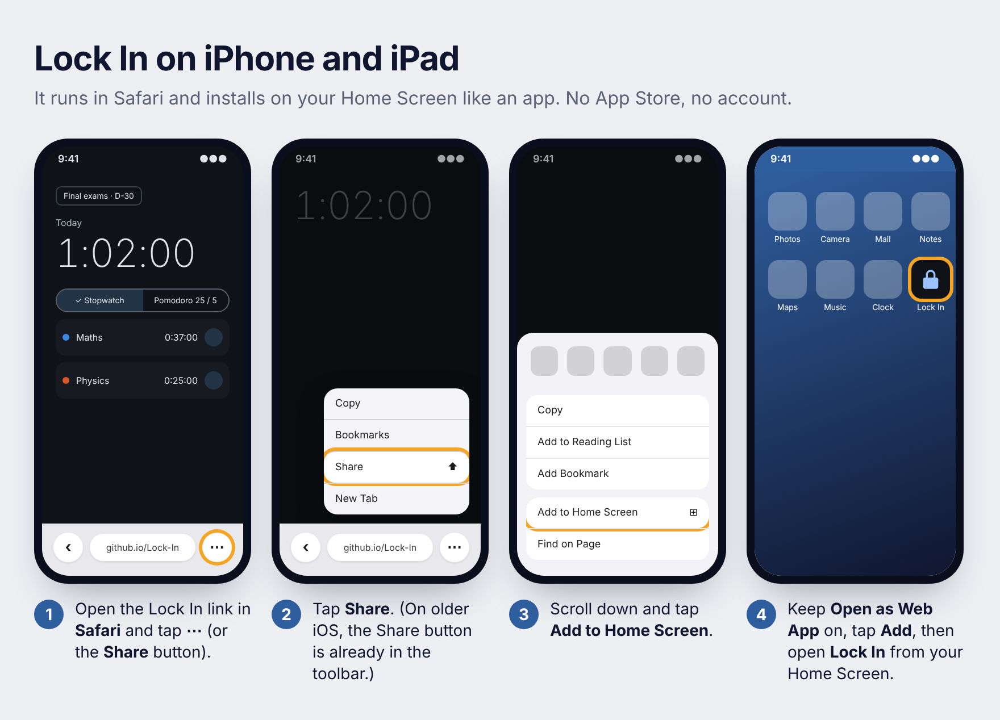

<p align="center">
  
</p>

<p align="center">
  <a href="https://tymonbitesthedust.github.io/Lock-In/"><b>Open on iPhone</b></a>
  &nbsp;·&nbsp; <a href="https://github.com/TymonBitesTheDust/Lock-In/releases/latest/download/Lock-In.apk"><b>Download for Android</b></a>
  &nbsp;·&nbsp; <a href="#features">Features</a>
  &nbsp;·&nbsp; <a href="#for-developers">For developers</a>
</p>

# Lock In

Lock In is a free study timer for students, inspired by Yeolpumta (YPT). Pick a subject, tap start and put your phone down. Lock In counts every second you study, even with the screen off, plans your week around your exams, and lets you study alongside friends. No ads, no account needed.

| Your device | How to get it |
|---|---|
| **iPhone or iPad** (iOS 16 or later) | Open **[Lock In](https://tymonbitesthedust.github.io/Lock-In/)** in Safari and add it to your Home Screen. [Steps below](#iphone-and-ipad) |
| **Android** (8.0 or later) | Download **[Lock-In.apk](https://github.com/TymonBitesTheDust/Lock-In/releases/latest/download/Lock-In.apk)** and open it. [Steps below](#android) |
| **Computer** | Open **[the same link](https://tymonbitesthedust.github.io/Lock-In/)** in Chrome, Edge or Safari |

## iPhone and iPad

No App Store needed: Lock In runs in Safari and installs on your Home Screen like any other app.

<p align="center">
  
</p>

1. On your iPhone, open **Safari** and go to **[tymonbitesthedust.github.io/Lock-In](https://tymonbitesthedust.github.io/Lock-In/)**.
2. Tap **⋯** next to the address bar, then **Share**. On older iPhones, tap the **Share** button (a square with an arrow) at the bottom of the screen.
3. Scroll down and tap **Add to Home Screen**. Keep **Open as Web App** turned on, then tap **Add**.
4. Open **Lock In** from your Home Screen. Always use this icon, not a Safari tab: the two keep separate data.

**Good to know on iPhone**

- **Your time keeps counting** when you lock the phone or close Lock In.
- **Pomodoro chimes** play only while Lock In is open. Turn on **Keep screen on** during a session and leave the phone face up.
- **Blocking apps:** iPhone doesn't let any app block other apps. In Lock In, open **Settings → Focus protection** for a 2-minute setup that uses a Study Focus and Screen Time instead.
- **Your data** is stored on your iPhone. Make a copy any time with **Settings → Export a backup**.
- **Updates** install themselves. When Lock In says a new version is ready, tap **Reload**.

## Android

1. On your phone, download **[Lock-In.apk](https://github.com/TymonBitesTheDust/Lock-In/releases/latest/download/Lock-In.apk)**.
2. Open the file. If Android asks, allow your browser to install apps.
3. Open Lock In. To block distracting apps during focus, follow **Settings → Focus protection**.

New versions install over the old one and keep your data. [All releases](https://github.com/TymonBitesTheDust/Lock-In/releases)

## Features

<p align="center">
  
</p>

- **Timer:** stopwatch or Pomodoro (25 / 5 by default). Only focus time counts as study time.
- **Planner:** a week at a glance, to-dos per day, and D-Day countdowns to your exams.
- **Stats:** day, week and month totals, time per subject, an 18-week heatmap and streaks.
- **Study groups:** join friends with a 6-letter code, see who's studying right now, compare hours and send a nudge. iPhone and Android friends can be in the same group.
- **Focus protection:** on Android, other apps are blocked during focus rounds. On iPhone, Lock In sets up a Study Focus and Screen Time limits.
- **Dark mode**, and a study day that starts at 5 am, so late-night sessions count for the evening they belong to.

**Privacy:** your study history stays on your device. If you join a study group, members see only your name, whether you're studying, the subject, and today's and this week's totals. No ads and no analytics.

## For developers

<details>
<summary>Build, release and Firebase setup</summary>

**Android app** (Kotlin, Jetpack Compose): JDK 17+, Android SDK Platform 37.

```bash
./gradlew :core:timer:test :core:model:test   # engine and stats tests
./gradlew :app:assembleDebug                   # app/build/outputs/apk/debug/app-debug.apk
```

**iPhone / web app** (`web/`, TypeScript and Preact): Node 22+. Details in [web/README.md](web/README.md).

```bash
cd web && npm install && npm test && npm run build
```

**Publishing**

- *Android:* raise `versionCode` and `versionName` in `app/build.gradle.kts`, update `.github/release-notes.md` and push to `main`. CI builds, tests on an emulator, then creates release `v<versionName>` with `Lock-In.apk`. Debug builds use the shared `keystore/debug.keystore`; never use it for a real release.
- *iPhone:* every push to `main` that changes `web/` is tested and published to GitHub Pages by `.github/workflows/web.yml`.

**Study groups (Firebase).** Without Firebase everything else works; the Groups tab says groups aren't set up.

1. In the Firebase console, create a project and turn on **Authentication → Email/Password**.
2. Create a Firestore database and publish [`firestore.rules`](firestore.rules) as its rules.
3. Android: add an Android app (`app.lockin`) and save its `google-services.json` as the repository secret `GOOGLE_SERVICES_JSON`.
4. iPhone: add a Web app, save its config as the repository secret `FIREBASE_WEB_CONFIG`, and add `tymonbitesthedust.github.io` under **Authentication → Settings → Authorized domains**.

Everything runs on the free Spark plan.

**More:** design decisions and how the timer survives sleep, battery savers and restarts are in [docs/ARCHITECTURE.md](docs/ARCHITECTURE.md).

</details>
