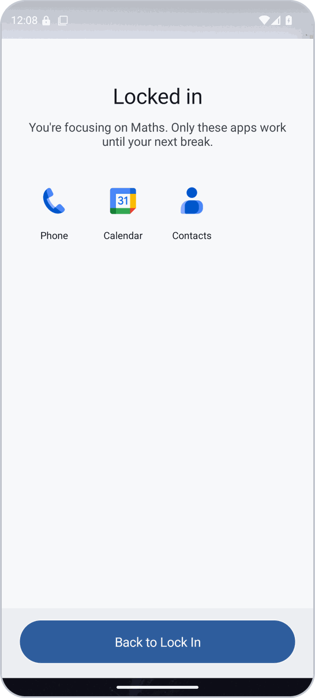
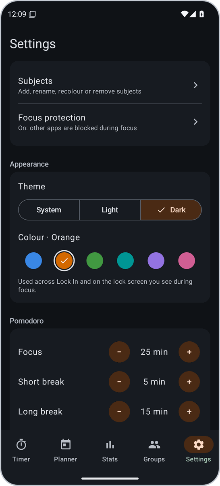
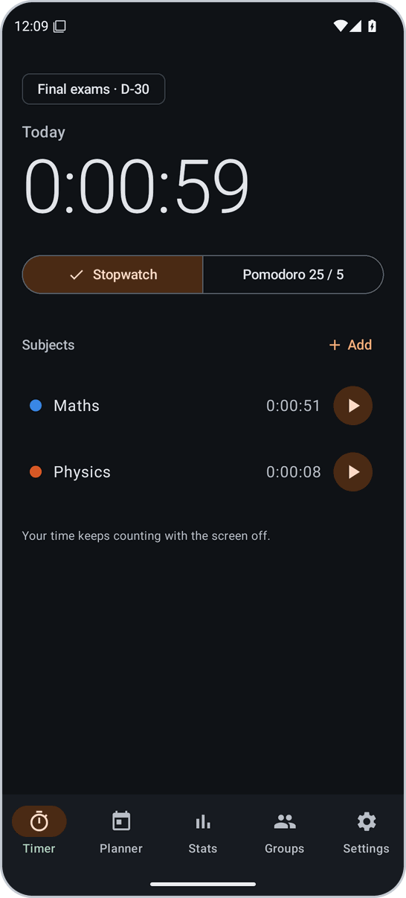
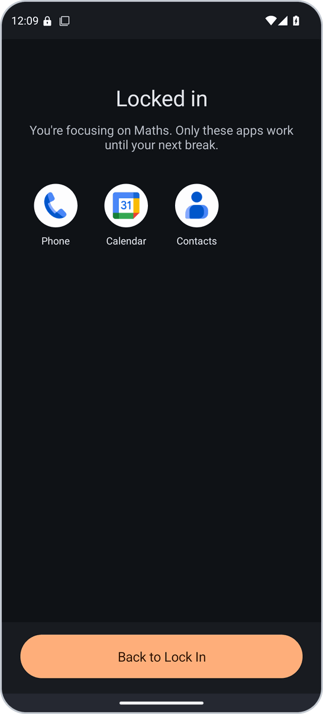
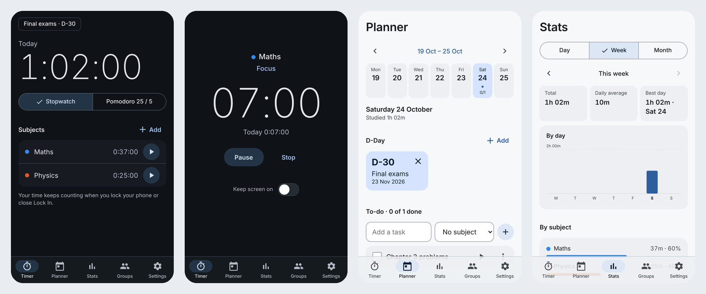
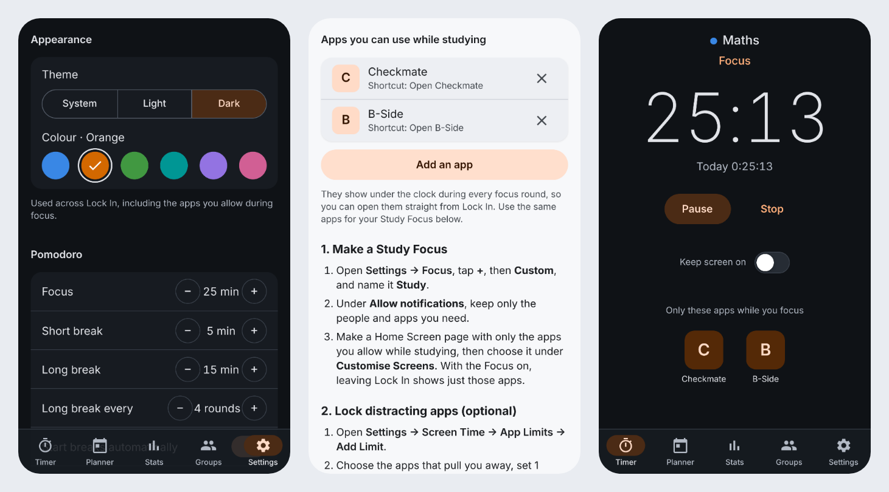

<p align="center">
  
</p>

# Lock In

Lock In is a study timer for Android and iPhone. Pick a subject, tap start and put your phone down. It counts every second you study, even with the screen off. During focus, only the apps you allow can be used. It also shows how much you actually studied, on your own or next to your friends.

| Device | What to download | Needs |
|---|---|---|
| **Android** | [`Lock-In.apk`](../../releases/latest/download/Lock-In.apk), the app | Android 8.0 or later. Uses the internet only for study groups |
| **iPhone, iPad, computers** | [Lock In in Safari](https://tymonbitesthedust.github.io/Lock-In/), added to your Home Screen | iOS 16 or later. [Setup steps](#iphone-and-ipad) |

> Lock In is inspired by Yeolpumta (YPT) but isn't affiliated with it.

## What it does

- **Counts every second, even with the screen off.** Lock In saves when your session started and works out the time from that, so a sleeping phone, a battery saver or a changed clock can't lose or add study time.
- **Stopwatch or Pomodoro.** Pomodoro runs focus rounds and breaks (25 / 5, with a long break every 4 rounds by default) and alerts you when each one ends. Only focus time counts as study time.
- **Only your allowed apps during focus.** Like Yeolpumta, leaving Lock In during a focus round brings up a lock screen that covers everything else, your home screen included. It shows the apps you allowed as shortcuts, plus Phone, and a button back to Lock In. Breaks and paused sessions never block anything.
- **Plans your week.** To-dos per day, tagged with a subject so you can start the timer straight from a task, plus D-Day countdowns to exams and a log of each day's sessions.
- **Shows what you actually did.** Day, week and month totals, time per subject, an 18-week heatmap and your streaks.
- **Studies with friends.** Join a group with a 6-character code to see who's studying right now, with their clocks ticking live, plus today's and this week's rankings, nudges and a chat that only opens on your break.
- **Looks the way you like.** Light, dark or follow your phone, in one of six colours: Blue, Orange, Green, Teal, Purple or Pink. The whole app and the lock screen follow it.

<table>
  <tr>
    <td width="33%"></td>
    <td width="33%"></td>
    <td width="33%"></td>
  </tr>
  <tr>
    <td><b>1. Pick a subject.</b> Tap ▶ next to it. Today's total sits at the top.</td>
    <td><b>2. Put your phone down.</b> The clock keeps going with the screen off.</td>
    <td><b>3. Stay locked in.</b> Leave Lock In and only your allowed apps open, until your next break.</td>
  </tr>
</table>

## Install

1. On your phone, download `Lock-In.apk` from the [latest release](../../releases/latest).
2. Open it. If Android asks, allow your browser or Files app to install unknown apps.
3. If the install is blocked, follow [the steps below](#if-the-install-is-blocked).
4. Open Lock In. Under **Subjects**, tap **Add** and add what you study, such as Maths or IELTS Reading.
5. Tap **▶** next to a subject. When Android asks, allow notifications so the timer shows in your notifications.
6. To block apps, go to **Settings → Focus protection**, turn on **Block apps during focus**, tap **Allow** on both permission cards and tick the apps you need while studying.
7. If a permission switch is greyed out or shows **Restricted setting**, follow [these steps](#if-a-permission-switch-wont-turn-on).
8. Check it works: start a session and press Home. The **Locked in** screen should appear within about a second, with the apps you ticked.

**Updating.** Download the new `Lock-In.apk` and open it. It installs over the old one and keeps your study history.

### If the install is blocked

- **Google Play Protect warns about the app.** Tap **More details**, then **Install anyway**.
- **On Samsung phones**, check **Settings → Security and privacy → Auto Blocker**. If it's on, turn it off while you install, then turn it back on.
- **In Brazil, Indonesia, Singapore and Thailand**, since 30 September 2026 Android only installs apps from developers registered with Google the usual way. If the install is refused there, install from a computer as described below.

**Still blocked?** Install from a computer instead. Apps installed this way usually skip both the install checks and the permission restriction below.

1. On the phone, open **Settings → About phone → Software information** and tap **Build number** seven times to unlock Developer options.
2. Turn on **Settings → Developer options → USB debugging**.
3. On the computer, install Google's free [Android SDK Platform-Tools](https://developer.android.com/tools/releases/platform-tools).
4. Connect the phone with a USB cable, accept the prompt on the phone, then run:
   ```bash
   adb install Lock-In.apk
   ```

### If a permission switch won't turn on

Android 15 and later restrict **Usage access** and **Display over other apps** for apps installed from a downloaded file. You unlock them once in the app's App info page, but that option only appears **after you've tried a switch once**. On Android 14 and earlier, the switches work straight away.

1. In Lock In, go to **Settings → Focus protection** and tap **Allow** next to **Usage access**. Tap **Lock In** in the list, then the switch. A **Restricted setting** message appears. Tap **OK**.
2. Go to **Settings → Apps → Lock In**, tap **⋮** in the top-right corner, then **Allow restricted settings**. Confirm with your PIN, pattern or fingerprint.
3. Back in Lock In, tap **Allow** next to **Usage access** again and switch Lock In on. Do the same for **Display over other apps**.
4. The **Two permissions needed** cards disappear once both are on.

Menus differ slightly between phones. If you see something else:

| What you see | What to do |
|---|---|
| No **Allow restricted settings** in the ⋮ menu | Do step 1 first. If it's still missing (some recent Samsung updates hide it), install with `adb` as described above. |
| **Blocked by your admin** | The phone is managed by Family Link or a work profile. Whoever manages it has to allow Lock In. |

## Using Lock In

| Part of the app | What it does |
|---|---|
| **Timer** | Today's total, your subjects with their time today, and the nearest D-Day in the corner. Choose **Stopwatch** or **Pomodoro**, then tap ▶ next to a subject. During a session: **Pause**, **Resume**, **Skip** (to the next round or break) and **Stop**. Paused time never counts. |
| **The notification** | While a session runs, Lock In stays in your notifications with a live clock and **Pause** / **Stop**. On Android 16 and newer it can also show as a small timer chip in the status bar. |
| **The lock screen** | Appears during a focus round when you leave Lock In for anything you haven't allowed, including your home screen. Tap an app to open it, or **Back to Lock In** (the Back gesture does the same). Phone is always there, so you can make calls. |
| **Planner** | A week at a glance. Add **D-Day** countdowns, add to-dos for any day (tag a subject, tap ▶ to start studying it, or **⋮ → Move to next day**), and see each day's study log. |
| **Stats** | Day, week and month views with total, daily average and best day, time **By subject**, and the **Consistency** heatmap with your current and best streak. |
| **Groups** | **Create account** or **Sign in**, then **Create group** or **Join with code**. See who's studying, rankings for **Today** and **This week**, **Nudge** a friend who isn't studying, and chat on your break. |
| **Settings** | **Subjects** (add, rename, recolour, remove), **Focus protection** (which apps you can use while studying), **Appearance** (theme and colour), Pomodoro lengths and auto-start, and **New day starts at**. The default is 5 am, so a late-night session still counts towards "today". |

<table>
  <tr>
    <td width="33%"></td>
    <td width="33%"></td>
    <td width="33%"></td>
  </tr>
  <tr>
    <td><b>Pomodoro.</b> Focus rounds and breaks, with an alert when each ends.</td>
    <td><b>Always counting.</b> A live clock in your notifications.</td>
    <td><b>Focus protection.</b> Tick the apps you need while studying. They become the lock screen's shortcuts.</td>
  </tr>
  <tr>
    <td></td>
    <td></td>
    <td></td>
  </tr>
  <tr>
    <td><b>Planner.</b> To-dos, D-Days and the day's log.</td>
    <td><b>Stats.</b> Totals, averages and subjects.</td>
    <td><b>Consistency.</b> 18 weeks at a glance.</td>
  </tr>
  <tr>
    <td></td>
    <td></td>
    <td></td>
  </tr>
  <tr>
    <td><b>Appearance.</b> Light, Dark or System, and six colours.</td>
    <td colspan="2"><b>Everywhere.</b> The app and the lock screen follow your choice.</td>
  </tr>
</table>

These screenshots are taken automatically on an Android emulator every time code is pushed. The totals are tiny because the test sessions only last a few seconds.

## Privacy and permissions

- **Your study data lives on your phone.** Sessions, subjects, to-dos, D-Days and settings are stored on the phone, not in an account. No ads or analytics.
- **Usage access is used only to see which app is in front, and only during focus.** Lock In checks about once a second while a focus round runs and the screen is on. What it sees isn't stored or sent.
- **Display over other apps is used only for the lock screen.**
- **No Accessibility access.** Lock In can't read what's on your screen or what you type.
- **Notifications** are asked for when you first start a session. Without them the timer still counts; you just don't see it in your notifications.
- **It starts at boot only if a session was running**, to bring that session back. Otherwise a restart doesn't wake Lock In.
- **Study groups are the only part that uses the internet.** If you never sign in, your data stays on the phone. If you do, sign-in goes through Firebase, and group members see only what's on the group screen: your display name, whether you're studying, on a break, paused or not studying, the subject, when your current session started, and your today and this-week totals. They don't see your apps, your usage or your planner. Messages and nudges are stored in the app's Firebase project.
- **Your status updates when something changes**, such as starting, pausing or switching subjects, not every second. Friends' phones run your clock themselves. Other signed-in users can read your status only if they know your account ID, which Lock In shares only with people in your groups.

## Troubleshooting

**Will I lose study time if…**

| What happens | Study time lost |
|---|---|
| The screen is off for hours | None. Android draws the notification clock itself. |
| A battery saver or Android closes Lock In | None. It picks the session up again from the saved start time. |
| A break alert arrives late | None. Rounds switch at their exact time anyway; only the alert is late. |
| You change the phone's clock or time zone | None. Durations never use the phone's clock. |
| The phone restarts or the battery dies | Usually under a minute. Lock In counts up to the last moment it saw the session running, pauses there and tells you. |

**The notification disappears or break alerts come late.** Android or a battery saver closed Lock In in the background. Your time is safe: open Lock In and it carries on. To stop it happening:
- Set **Settings → Apps → Lock In → Battery** to **Unrestricted**. The wording differs between phones.
- On Xiaomi, Huawei, Honor, OPPO, realme, OnePlus and vivo, also allow **Autostart** or background activity for Lock In in the phone's own battery or app settings.
- For on-time break alerts on Android 16 and earlier, turn on Lock In under **Settings → Apps → Special app access → Alarms & reminders**.

**"Your timer is still counting."** Android didn't let Lock In bring its live notification back in the background. Tap the notification and the live timer returns. No time was lost.

**"Paused after a restart."** Your phone restarted or ran out of battery during a session. Everything up to the restart was counted. Tap **Resume** to carry on.

**I can't get to my home screen during focus.** That's on purpose: during a focus round the lock screen covers it. Open your allowed apps from the lock screen, or pull down the notification and tap **Pause** or **Stop**. Everything unlocks on your next break.

**An app is missing from the lock screen.** Only apps you tick in **Settings → Focus protection** appear there, and only apps with an icon in your app drawer. Phone is always included.

**Apps aren't being blocked.** Check that:
- **Settings → Focus protection** says **On**, and no permission cards are showing on that screen.
- A focus round is running. Breaks, paused sessions and the time between sessions never block.
- The app isn't ticked in the list. Phone calls, Settings and Lock In are always allowed.
- You've waited a second. The lock screen can take up to about a second to appear.

**Groups say they aren't connected.** That APK was built without the app's Firebase project. Everything else works. Setting it up is described [for developers](#for-developers).

**A nudge arrived late.** Nudges arrive instantly while your friend's Lock In is running, which is always the case during a session, and within about 15 minutes otherwise.

**"App not installed" when updating.** The new APK was signed with a different key than the one you have. This happens if you still have the very first test build (0.1.0). Uninstall Lock In first, then install the new one. This deletes your study history, subjects and planner.

**Something else is wrong.** Please [open an issue](../../issues) with your phone model, Android version and Lock In version (shown in **Settings → Apps → Lock In**).

## iPhone and iPad

iOS doesn't let apps outside the App Store cover or block other apps, so Lock In for iPhone is a web app you add to your Home Screen. It has the same timer rules, planner, D-Days, stats, study groups and colour themes, and iPhone and Android friends can be in the same group.

<p align="center">
  
</p>

1. Open **[Lock In](https://tymonbitesthedust.github.io/Lock-In/)** in **Safari**.
2. Tap **Share**, then **Add to Home Screen**, then **Add**.
3. Open Lock In from your Home Screen from now on. It works offline, and Safari won't clear its data the way it can for websites you haven't opened for a week.

**Your allowed apps.** Add them in **Settings → Focus protection → Add an app**: pick a common one (Music, Notes, Calendar, Books, Files, Spotify, Notion), or type an app's link or the name of a Shortcut that opens it. For any app, make a Shortcut in the Shortcuts app with **Open App**. They show under the clock during every focus round, like the lock screen on Android.

<p align="center">
  
</p>

**What you see when you leave Lock In.** iOS decides that, not Lock In, but a Focus gets close to Android's lock screen:
1. In **Settings → Focus**, tap **+**, then **Custom**, and name it **Study**.
2. Make a Home Screen page with only your allowed apps, and choose it under **Customise Screens**.
3. In the Shortcuts app, make **Lock In Start** (**Set Focus → Study → On**) and **Lock In Stop** (**Set Focus → Study → Off**), and type their names in Lock In's **Focus protection**.

Now starting a session switches the Focus on, and leaving Lock In shows just your allowed apps. For apps that must stay closed, Focus protection also walks you through **Screen Time** limits.

**Different from Android.** Time always keeps counting, but the end-of-round chime only plays while Lock In is open, and there's no notification with a live clock. Lock In can keep the screen on during a session instead. Data stays on the device you use; the web app and the Android app don't share it, except for study groups.

How it's built: [web/README.md](web/README.md).

## For developers

| Path | What it is |
|---|---|
| `app/` | `Application`, `MainActivity` (applies the theme), tab navigation and the Hilt root |
| `core/timer/` | The timer engine, a pure Kotlin function with no Android code. The hard cases (deep sleep, late alarms, reboots, clock changes) are plain unit tests here |
| `core/model/` | Study-time maths (the study day, totals, streaks, D-Day labels) and the theme colours (`Appearance.kt`). Also pure Kotlin |
| `core/database/`, `core/data/` | The Room tables and the repositories on top of them |
| `core/network/` | Firebase sign-in, groups, presence, chat and nudges. Does nothing when Firebase isn't configured |
| `core/designsystem/` | `LockInTheme`, charts, heatmap and shared components |
| `system/timer/` | The foreground service, notifications, alarms and boot handling |
| `system/blocker/` | Foreground-app detection and the lock screen with the allowed-app shortcuts |
| `system/presence/` | Publishes your live status and shows nudges |
| `feature/*` | One area of the app each: timer, planner, stats, subjects, blocker, settings, groups |
| `build-logic/` | Gradle convention plugins (`lockin.android.*`, `lockin.hilt`, `lockin.jvm.library`) |
| `web/` | The iPhone web app: a TypeScript port of the timer engine and stats, a Preact UI, and a service worker |
| `firestore.rules` | Security rules for the Firebase project, shared by Android and the web app |
| `scripts/ui-smoke.sh` | Walks every screen on an emulator, saves screenshots and fails on any crash |
| `docs/ARCHITECTURE.md` | The foreground service type, alarms, surviving battery killers, and why each choice was made |

**Build the APK.** You need JDK 17 or later, an Android Studio release that supports AGP 9.4, and Android SDK Platform 37.
```bash
./gradlew :core:timer:test :core:model:test   # engine, controller and stats tests, plain JVM
./gradlew :app:assembleDebug                   # app/build/outputs/apk/debug/app-debug.apk
```

**Build the web app.** You need Node 22 or later.
```bash
cd web
npm install
npm test             # engine, stats, storage, theme and allowed-app tests
npm run build        # web/dist
npm run e2e          # end-to-end tests on an iPhone-sized screen
```

**Theme colours.** The six accents live in `core/model/.../Appearance.kt` and, with the same values, in `web/src/core/model.ts`. Each one is the original blue with only the hue changed, so button text stays above 6.5:1 contrast and the accent above 5.6:1 against the surfaces. The web tests check that for every accent.

**CI.** Every push to any branch (except changes only to `web/`) runs the Android tests and builds the APK on GitHub Actions (artifact `lock-in-debug-apk`), with the build log mirrored to the `ci-output` branch. It then installs the APK on an emulator and walks every screen with `scripts/ui-smoke.sh`, including the lock screen and the Orange / Dark theme. The screenshots land on the `ci-ui` branch; the ones in this README come from there. The web app has its own workflow, `.github/workflows/web.yml`, which runs on pull requests and on `main`, and deploys to GitHub Pages from `main`.

**Set up study groups (Firebase).** Without Firebase the app works fully and the Groups tab says groups aren't connected.
1. In the Firebase console, create a project, add an Android app with package `app.lockin`, and download `google-services.json`.
2. **Authentication → Sign-in method** → enable **Email/Password**.
3. **Firestore Database** → create (production mode) → **Rules** → paste [`firestore.rules`](firestore.rules) → **Publish**.
4. For local builds, put the file at `app/google-services.json` (it's git-ignored). For CI, save its contents as the repository secret `GOOGLE_SERVICES_JSON`.
5. For the iPhone web app, add a **Web** app to the same project and save its config as the repository secret `FIREBASE_WEB_CONFIG`. Steps in [web/README.md](web/README.md#study-groups-firebase).

Everything runs on the free Spark plan. Instant nudges to a closed app would need FCM sent from a Cloud Function, which needs the Blaze plan.

**The signing key.** Android only accepts an update if it's signed with the same key as the version already installed. Lock In's releases are debug builds signed with `keystore/debug.keystore`, which is committed to this repository with the password `android`. That's why every new APK installs over the old one.
- **Anyone can use that key.** Because the key and its password are public, anyone can build an APK that phones accept as a Lock In update. Download Lock In only from this repository's [releases](../../releases), and tell friends to do the same.
- **Before sharing Lock In widely or publishing it on Google Play,** switch to a private release key and keep it out of the repository. Everyone will have to uninstall once when that happens, so do it early.

**Publishing a release.**
1. Bump `versionCode` and `versionName` in `app/build.gradle.kts`.
2. Update `.github/release-notes.md`.
3. Push to `main`. The workflow builds, runs the emulator test, and only then creates release `v<versionName>` with `Lock-In.apk` attached. Pushes that don't change the version never touch an existing release, and other branches never publish one. Pushing a matching `v*` tag re-uploads the APK to that release.

The web app needs no release: every push to `main` that changes `web/` is tested and published to GitHub Pages, and installed copies update themselves.

The README's download and issue links are relative (`../../releases/latest`, `../../issues`). They work in any GitHub repository without editing, as long as:
- `README.md` stays at the top of the repository;
- each release is published, not saved as a draft or marked as a pre-release ("latest" skips both), and has `Lock-In.apk` attached with exactly that name;
- Issues stay turned on (**Settings → General → Features → Issues**).

These links only work on github.com, not when you open `README.md` on your computer.

## Licences

The Android app is built on AndroidX, Jetpack Compose, Kotlin coroutines and Dagger Hilt, all under the Apache License 2.0, and Google's Firebase Authentication and Cloud Firestore SDKs. The web app uses Preact and Preact Signals (MIT) and the Firebase JavaScript SDK (Apache License 2.0). Neither bundles fonts; both use the device's system font.
