<p align="center">
  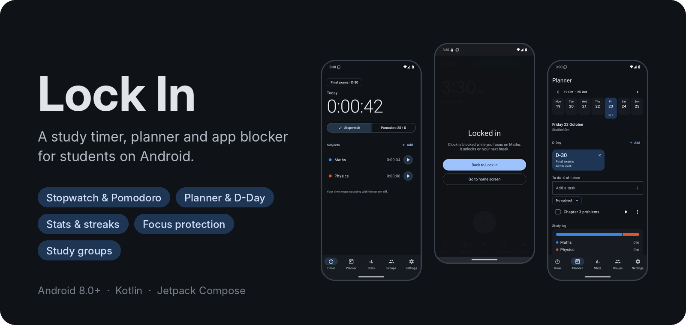
</p>

<p align="center">
  <a href="https://github.com/TymonBitesTheDust/Lock-In/releases/latest/download/Lock-In.apk"><b>Download the APK</b></a>
  &nbsp;·&nbsp; <a href="#a-quick-tour">Tour</a>
  &nbsp;·&nbsp; <a href="#how-it-works">How it works</a>
  &nbsp;·&nbsp; <a href="docs/ARCHITECTURE.md">Architecture</a>
</p>

# Lock In

**Lock In** is a focus and study-tracking app for Android, inspired by Yeolpumta (YPT). Pick a subject, tap start and put your phone down. Lock In counts every second you study, even with the screen off. While you focus it blocks the apps that distract you, and it plans your week around your exams. It also shows how much you actually studied, on your own or next to your friends.

It's built for long study sessions: a calm, dark-friendly design, no ads, and nothing leaves your phone unless you join a study group.

## Download

**[Download the latest APK](https://github.com/TymonBitesTheDust/Lock-In/releases/latest/download/Lock-In.apk)** (Android 8.0+) · [All releases](https://github.com/TymonBitesTheDust/Lock-In/releases)

On your phone, open the file and allow your browser to install unknown apps when asked. New versions install over the old one and keep your data.

## A quick tour

> These screenshots are real. CI takes them automatically on an Android emulator every time code is pushed. The stats look nearly empty because the test sessions only last a few seconds.

### 1. Pick a subject and start

<table>
  <tr>
    <td width="33%">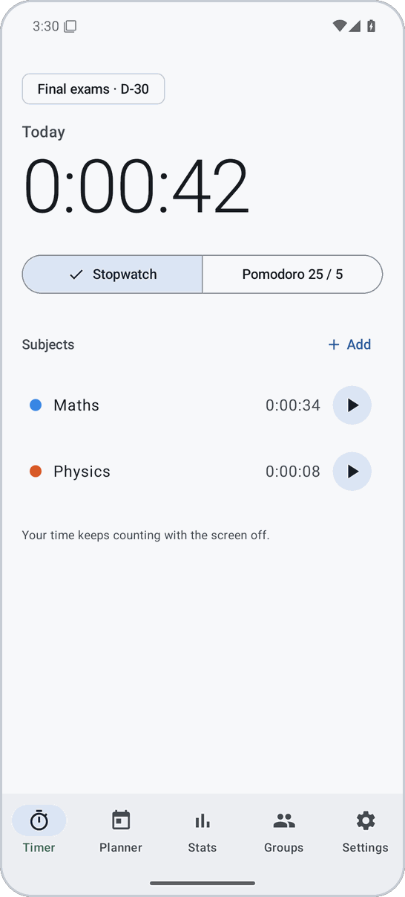</td>
    <td width="33%">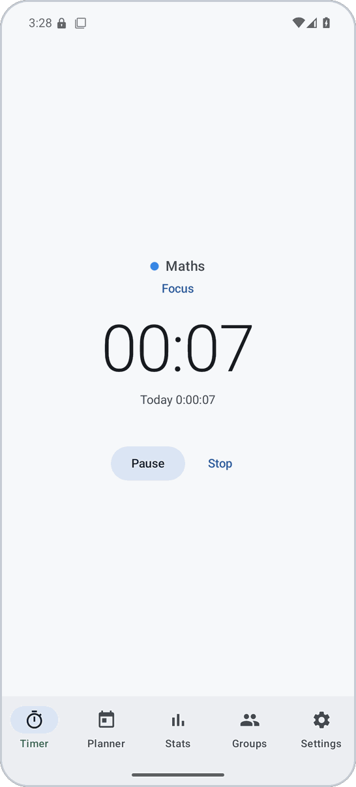</td>
    <td width="33%">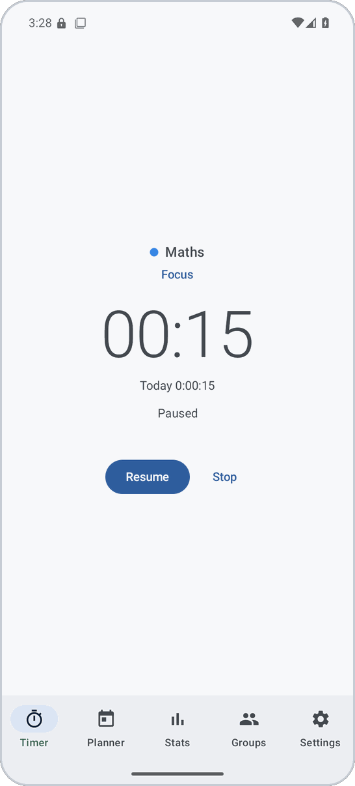</td>
  </tr>
  <tr>
    <td><b>Home.</b> Today's total at the top, your subjects below with their time today. Tap ▶ next to a subject to start. The nearest exam countdown sits in the corner.</td>
    <td><b>Studying.</b> A big, calm clock and nothing else. Today's total keeps growing underneath.</td>
    <td><b>Paused.</b> Paused time never counts. Resume when you're back, or stop to save the session.</td>
  </tr>
</table>

### 2. Lock your phone and keep going

<table>
  <tr>
    <td width="50%">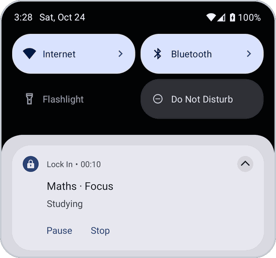</td>
    <td width="50%">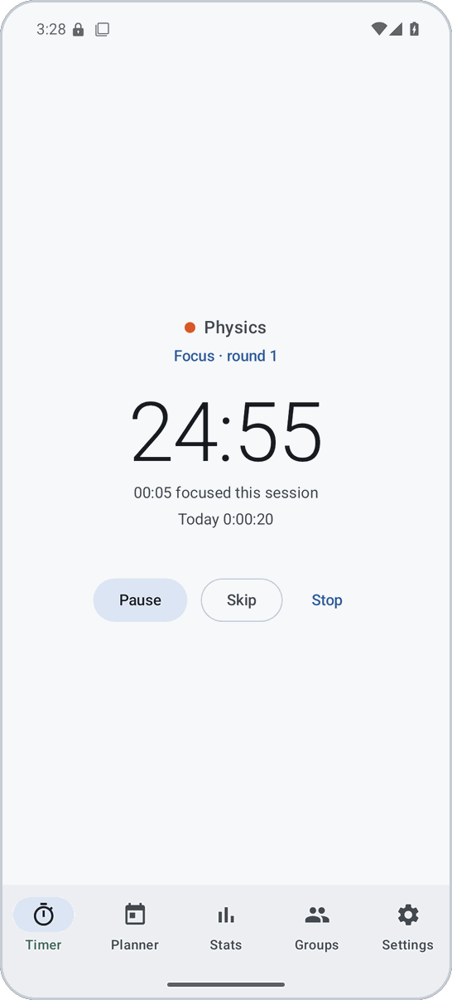</td>
  </tr>
  <tr>
    <td><b>Always counting.</b> While a session runs, Lock In stays in your notifications with a live clock and Pause / Stop buttons. On Android 16 and newer it can also appear as a small timer chip in the status bar.</td>
    <td><b>Pomodoro.</b> Switch from Stopwatch to Pomodoro for focus rounds and breaks (25 / 5, with a long break every 4 rounds by default). You get an alert when a round or a break ends, and only focus time counts as study time.</td>
  </tr>
</table>

### 3. Focus protection

<table>
  <tr>
    <td width="50%">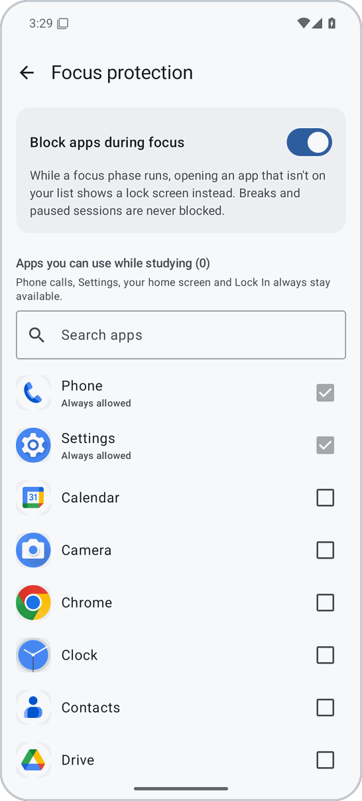</td>
    <td width="50%">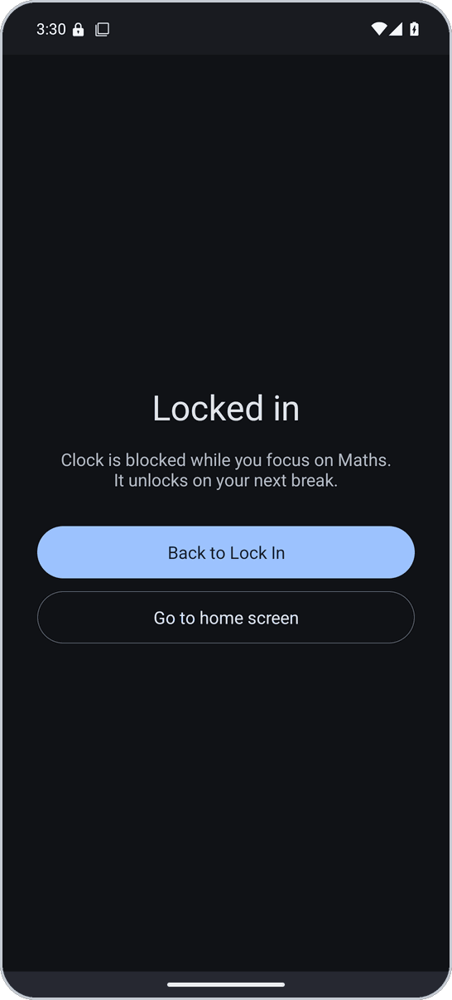</td>
  </tr>
  <tr>
    <td><b>Choose what's allowed.</b> Turn on <i>Block apps during focus</i> and tick the apps you need while studying. Phone calls, Settings, your home screen and Lock In itself are always allowed.</td>
    <td><b>Locked in.</b> Open anything else during a focus round and a lock screen covers it, telling you it unlocks on your next break. Breaks and pauses never block anything.</td>
  </tr>
</table>

### 4. Plan your week and see your progress

<table>
  <tr>
    <td width="33%">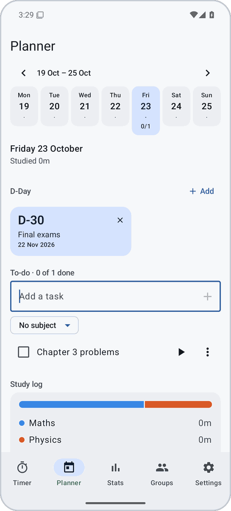</td>
    <td width="33%">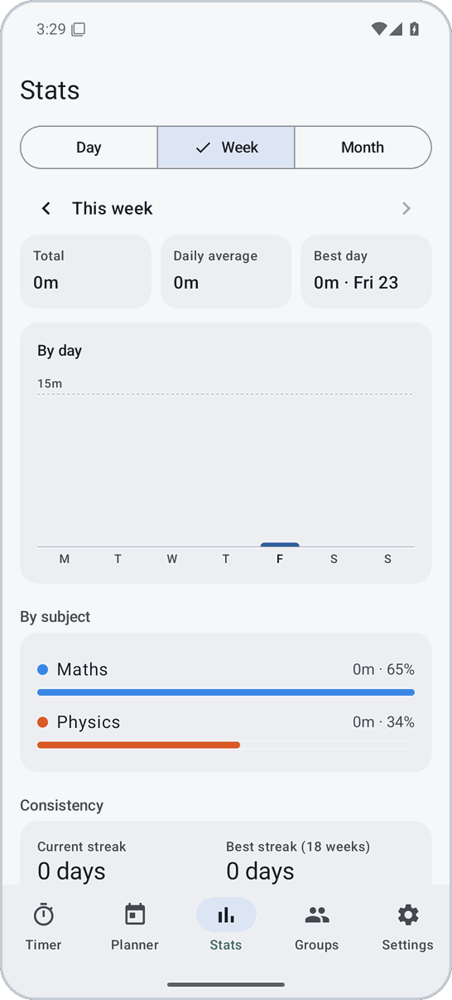</td>
    <td width="33%">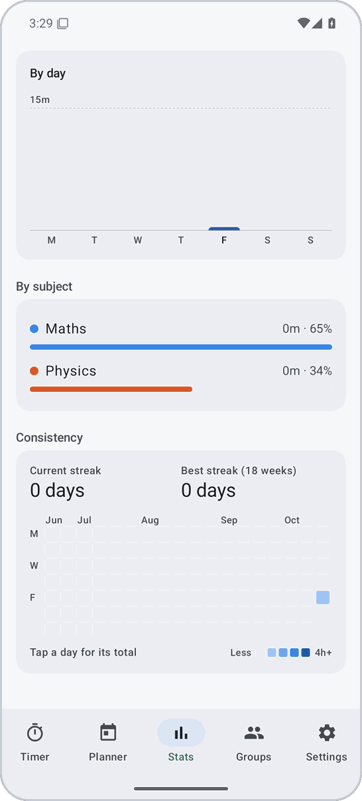</td>
  </tr>
  <tr>
    <td><b>Planner.</b> A week at a glance, to-dos per day (tag a subject and start the timer straight from a task), D-Day countdowns to exams, and the day's study log.</td>
    <td><b>Stats.</b> Day, week and month views: total, daily average, best day, and how your time splits across subjects.</td>
    <td><b>Consistency.</b> An 18-week heatmap like GitHub's, plus your current and best streak. Tap a day to see its total.</td>
  </tr>
</table>

### 5. Make it yours

<table>
  <tr>
    <td width="33%">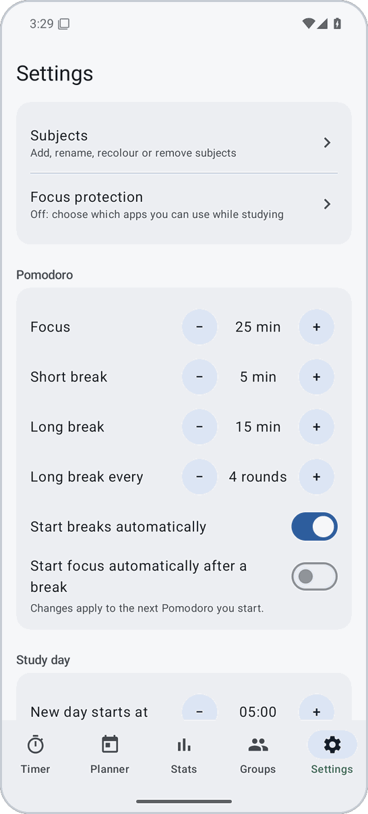</td>
    <td width="33%">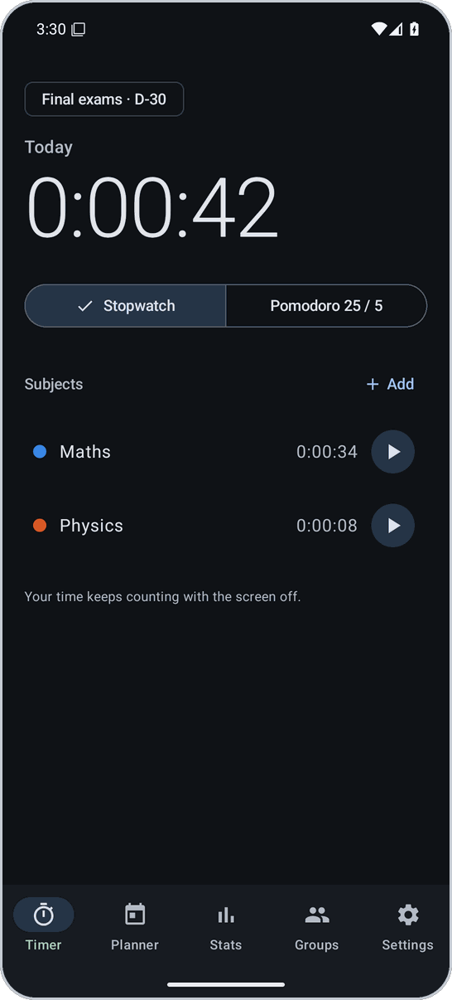</td>
    <td width="33%">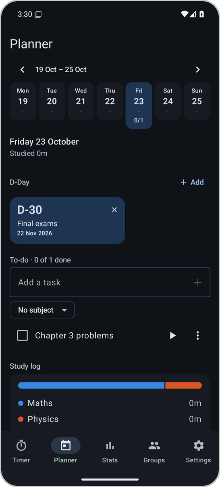</td>
  </tr>
  <tr>
    <td><b>Settings.</b> Subjects (add, rename, recolour), Pomodoro lengths and auto-start, and when your study day begins. The default is 5 am, so a late-night session still counts towards "today".</td>
    <td colspan="2"><b>Dark mode.</b> Follows your phone. Designed dark-first for late-night sessions.</td>
  </tr>
</table>

### 6. Study groups

Create a group or join one with a 6-character code. You'll see who's studying right now and what subject, with their clocks ticking live, plus today's and this week's rankings. You can send a "shake to wake" nudge to a friend who's slacking, and chat with the group. Chat only opens outside focus, so it never becomes the distraction. Groups need the app's Firebase project to be set up ([see below](#firebase-study-groups)); everything else works without it.

## How it works

### Your time is a start time, not a counter

Most timers add one to a counter every second. If the phone falls asleep or the battery saver closes the app, those seconds are lost. Lock In instead remembers **when** your session started, using a clock that keeps running while the phone sleeps. Every number you see is just *now − start*, worked out fresh each time.

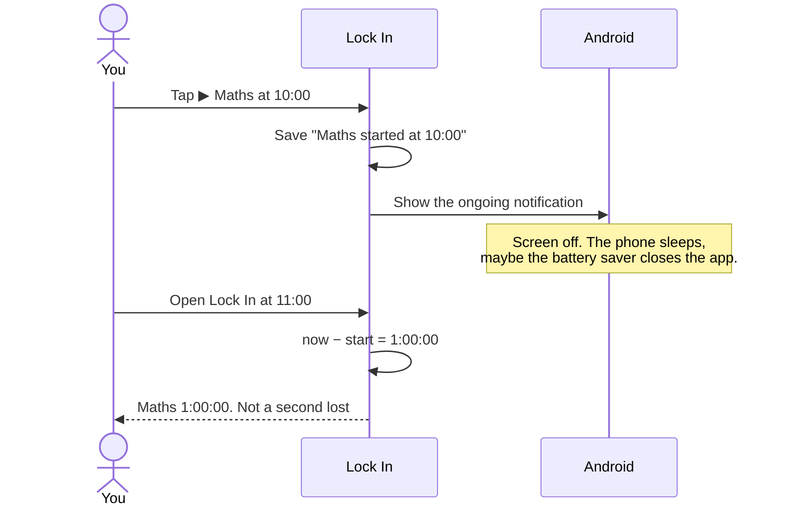

That makes the timer hard to break:

| What happens | What Lock In does | Study time lost |
|---|---|---|
| Screen off for hours | Nothing has to keep counting; Android draws the notification clock itself | None |
| Battery saver or the system closes the app | Picks the session back up on the next start, from the saved start time | None |
| A break alert arrives late | Phases switch at their exact time anyway; only the alert is late | None |
| You change the phone's clock or time zone | Durations never use the wall clock, so moving it can't add or remove study time | None |
| The phone restarts or the battery dies | Counts up to the last moment the app was seen running, pauses there and tells you | Usually under a minute |

### How focus protection decides

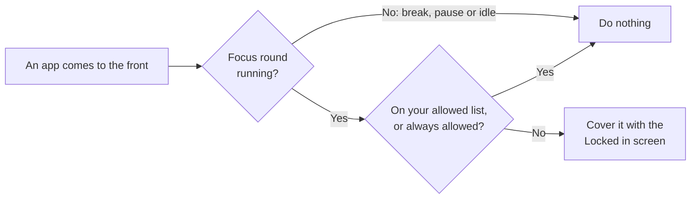

During a focus round, Lock In checks which app is in front about once a second. It uses Android's *usage access*, and that information never leaves your phone and is never stored. The lock screen is drawn with *display over other apps*. Both are switches you turn on in Android's settings, and Lock In walks you through them. No accessibility service is used.

### What study groups can see

Only what's on the group screen: your display name, whether you're studying, on a break, paused or idle, the subject name, when your current session started, and your today and this-week totals. Group members don't see your app usage or your planner. Your status is updated when something changes (you start, pause or switch subjects), not every second. Your friends' phones run the clocks locally, so it's light on battery and data.

### Under the hood

Kotlin, Jetpack Compose and Material 3, with Hilt, Room, DataStore and a foreground service. The timer engine is a pure Kotlin function with no Android code, so the hard cases (deep sleep, late alarms, reboots, clock changes) are covered by plain unit tests.

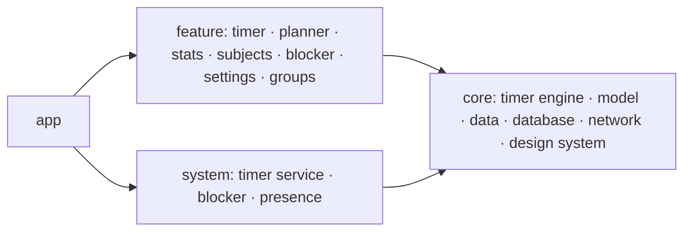

The full design (foreground service type, alarms, surviving battery killers, and why each choice was made) is in **[docs/ARCHITECTURE.md](docs/ARCHITECTURE.md)**.

## Build

Requirements: JDK 17+, an Android Studio release that supports AGP 9.4, Android SDK Platform 37.

```bash
./gradlew :core:timer:test :core:model:test   # engine, controller and stats tests, plain JVM
./gradlew :app:assembleDebug                   # app/build/outputs/apk/debug/app-debug.apk
```

Every push to `main` builds the APK on GitHub Actions (artifact `lock-in-debug-apk`) and runs it on an emulator, walking every screen (`scripts/ui-smoke.sh`). The screenshots land on the `ci-ui` branch; the ones in this README come from there.

To publish a release: bump `versionCode` and `versionName` in `app/build.gradle.kts`, update `.github/release-notes.md`, and push to `main`. The workflow builds, runs the emulator test, and only then creates release `v<versionName>` with `Lock-In.apk` attached. Pushes that don't change the version never touch an existing release. Debug builds are signed with the shared `keystore/debug.keystore`, so a new APK installs over the old one. Never use that key for release.

## Firebase (study groups)

Without Firebase the app works fully; the Groups tab says groups aren't connected.

1. In the Firebase console, create a project, add an Android app with package `app.lockin`, and download `google-services.json`.
2. Authentication → Sign-in method → enable **Email/Password**.
3. Firestore Database → create (production mode) → **Rules** → paste [`firestore.rules`](firestore.rules) → Publish.
4. Local builds: put the file at `app/google-services.json` (git-ignored). CI: save its contents as the repository secret `GOOGLE_SERVICES_JSON`.

Everything runs on the free Spark plan. Nudges arrive instantly while the friend's app is running and within about 15 minutes otherwise; instant delivery to a closed app needs FCM from a Cloud Function (Blaze plan).

## Layout

```
app/                  Application, MainActivity, tab navigation, Hilt root
build-logic/          Convention plugins (lockin.android.*, lockin.hilt, lockin.jvm.library)
core/timer/           Pure-Kotlin timer engine, controller, ports (no Android)
core/model/           Pure-Kotlin domain models and study-time maths (no Android)
core/database/        Room schema and DAOs
core/data/            Repositories, preferences, Room record sink, session launcher
core/network/         Firebase auth, groups, presence, chat, nudges
core/designsystem/    Theme, charts, heatmap, shared components
system/timer/         StudyTimerService, notifications, alarms, receivers, DataStore
system/blocker/       Foreground-app detection and the lock overlay
system/presence/      Live status publishing, nudge notifications and background check
feature/*             timer, planner, stats, subjects, blocker, settings, groups
docs/                 Architecture and README images
```
