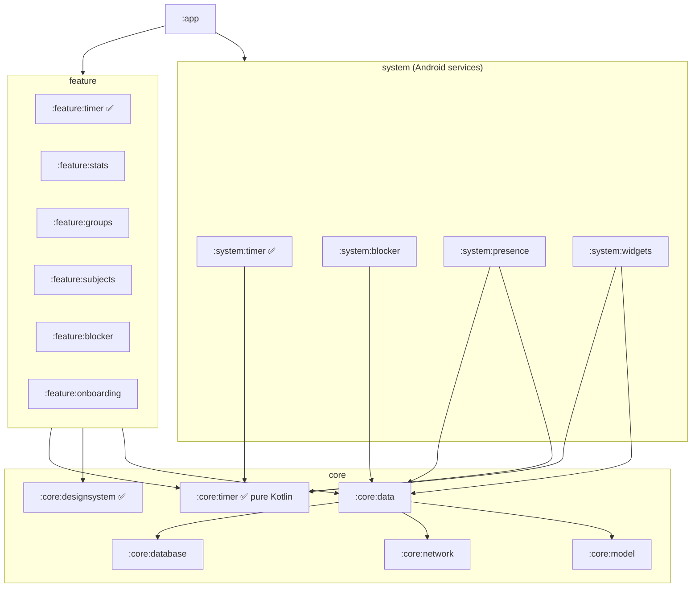
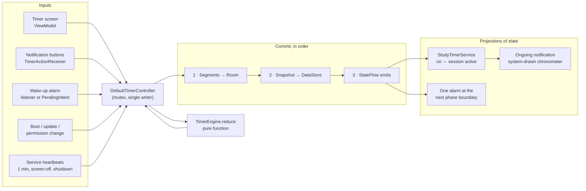

# Lock In: Android Architecture

Version 0.1 · 24 Oct 2026 · Scope of this revision: system architecture and the study-timer foreground service (both implemented in this repository). App blocking, the Room schema, live presence and the sprint roadmap follow as separate revisions.

---

## 1. Platform baseline

Checked against official release pages on 24 Oct 2026.

| Item | Choice | Why |
|---|---|---|
| compileSdk / targetSdk | **37** (Android 17) | Android 17 reached Pixels on 16 Jun 2026. Play has required API 36 for new apps and updates since 31 Aug 2026; targeting 37 now absorbs the Android 17 changes before next year's deadline. |
| minSdk | **26** | Notification channels everywhere. WorkManager 2.12 needs 24 and Room 2.8 needs 23, so 26 costs almost nothing. |
| Build | AGP **9.4.0**, Gradle **9.6.0**, JDK 17 | AGP 9 compiles Kotlin itself ("built-in Kotlin"); modules no longer apply `org.jetbrains.kotlin.android`. |
| Language | Kotlin **2.4.21**, KSP **2.3.11** | No kapt anywhere. |
| DI | Hilt **2.60.1** | Compile-time graph; first-class injection into Services, BroadcastReceivers, ViewModels and Workers, which this app leans on. Hilt 2.59+ requires AGP 9. Koin's runtime resolution buys nothing here. |
| UI | Compose BOM **2026.09.00** (Material 3 1.4.0) | 100% Compose. |
| Navigation | Navigation 3 **1.2.0** (when the second screen lands) | Compose-first, the back stack is plain state the app owns, which fits MVI. |
| Local data | DataStore **1.3.0** (live session), Room **2.8.5** (history, next revision) | See principle 4. |
| Background | Foreground service, AlarmManager, WorkManager **2.12.0** | Each has one job; see §5.7. |

## 2. Five rules the rest of the design follows

1. **Time is derived, never counted.** A running session stores *when* it started on the monotonic clock, nothing else. Every number on screen is `banked + (now − since)`. There is no tick to drop.
2. **Services and alarms are projections of state.** After every state change the controller re-derives "should the foreground service run?" and "when is the next wake-up?". Neither is ever the source of truth, so neither can drift from it.
3. **Functional core, imperative shell.** `TimerEngine` is a pure function `(state, command, now) → (state, effects)` in a plain-Kotlin module. All the hard cases (Doze, late alarms, reboots, clock changes) are JVM unit tests. Android code only moves data in and out.
4. **Offline-first, one writer per store.** The live session lives in one small DataStore file; finished focus time lives in Room as segments. The network (presence, leaderboards) only ever reads from these, never the other way round.
5. **"Daily reset" is a query, not a job.** A study day is a time window (default 05:00 to 05:00 local, user-configurable). Totals are computed from segments by window. Nothing has to run at midnight for the numbers to be right.

## 3. Module structure



✅ = exists in this repository. Everything else is created in the sprint that needs it.

| Module | Kind | Owns |
|---|---|---|
| `:app` | Android app | `Application`, `MainActivity`, navigation host, the full Hilt graph. |
| `:core:timer` | Pure Kotlin | Timer engine, state model, snapshot codec, `TimerController` interface and its default implementation, platform ports. Zero Android imports. |
| `:core:designsystem` | Android + Compose | Theme, typography (tabular clock digits), shared components, Canvas charts (heatmap, rings). |
| `:core:model` | Pure Kotlin | Domain models shared across features (Subject, StudyGroup, Member). |
| `:core:database` | Android | Room database, entities, DAOs, migrations. |
| `:core:network` | Android | Realtime and REST clients, DTOs. |
| `:core:data` | Android | Repositories; offline-first sync orchestration (WorkManager workers live here). |
| `:system:timer` | Android | `StudyTimerService`, notifications, alarms, boot handling, DataStore snapshot store, OEM reliability helpers. Binds the `:core:timer` ports to Android. |
| `:system:blocker` | Android | UsageStats monitor, AccessibilityService, overlay. Attaches to the timer service lifecycle. |
| `:system:presence` | Android | Lifecycle-aware presence publisher and subscriber. |
| `:system:widgets` | Android | Jetpack Glance widgets (D-Day, quick start). |
| `:feature:*` | Android + Compose | One user-facing area each: screens, ViewModels (MVI). |

**Dependency rules** (enforced by convention plugins and review):
- Features never depend on other features or on `:system:*`. They see the timer only through the `TimerController` interface in `:core:timer`; Hilt supplies the implementation from `:system:timer`.
- `:core:timer` never gains an Android dependency. If something needs Android, it becomes a port (interface) with an adapter in `:system:timer`.
- `:system:*` modules may depend on `:core:*`, never on `:feature:*`.
- Only `:app` sees everything.

Build configuration lives in `build-logic` convention plugins: `lockin.android.application`, `lockin.android.library`, `lockin.android.compose`, `lockin.android.feature`, `lockin.hilt`, `lockin.jvm.library`.

## 4. How a session flows at runtime



Writes happen before the state is published, and projections happen after. A crash between any two steps is safe: on restart the previous snapshot is replayed, which re-emits the same segments under the same `(sessionId, index)` keys (the Room sink upserts), and projections are rebuilt from scratch.

## 5. Study timer and foreground service

### 5.1 Foreground service type: `specialUse`

Since Android 14 every foreground service must declare a type, and the type must honestly describe the work. The candidates:

| Type | Verdict |
|---|---|
| `dataSync` | No. Capped at 6 hours per 24 since Android 15, cannot start from `BOOT_COMPLETED`, and a study timer is not data sync. Misdeclaring it is a Play policy risk. |
| `shortService` | No. About 3 minutes. |
| `health` | No. Meant for fitness trackers and requires body-sensor or health-data permissions. |
| `mediaPlayback` | Only if we add focus sounds (§5.12), and then as a second type on the same service. |
| **`specialUse`** | **Yes.** The catch-all for valid uses no other type covers. No time limit, may start from `BOOT_COMPLETED`. Requires `FOREGROUND_SERVICE_SPECIAL_USE`, a `PROPERTY_SPECIAL_USE_FGS_SUBTYPE` explanation in the manifest, and a declaration in Play Console (Policy › App content). Play reviews the explanation. |

The manifest subtype text describes all three things the service does during a session (visible timer, app blocking, group status), so the declaration stays accurate as the blocker and presence features attach to the same service.

### 5.2 State model

`TimerState.Active` holds only facts that cannot be derived:

| Field | Meaning |
|---|---|
| `run = Running(since)` / `Paused(reason, atWall)` | `since` is a `TimePoint` (elapsed + wall + boot count). Reasons: `USER`, `AWAITING_NEXT_PHASE`, `INTERRUPTED`. |
| `phaseBankedMs`, `focusBankedMs` | Totals of segments already closed. |
| `phase`, `focusRounds` | Pomodoro position (`FOCUS`, `SHORT_BREAK`, `LONG_BREAK`). |
| `nextSegmentIndex` | Key for the next focus segment; makes Room writes idempotent. |
| `lastAlive` | Last instant a live process saw the session; used only after a reboot. |

Commands: `Start`, `Pause`, `Resume`, `SkipPhase`, `Stop`, `Reconcile` (catch up), `Heartbeat`.
Effects the engine emits: `RecordSegment`, `SessionFinished`, `PhaseChanged`, `Interrupted`, `Ignored`. Alarms and the service are not effects (rule 2).

Every `reduce` call first replays what happened between the last observation and now: reboot recovery, then every Pomodoro boundary crossed **at its exact instant**, then the command. A break alarm that fires four minutes late changes when the user hears about it, never the recorded time.

### 5.3 Clocks

| Clock | Used for | Never used for |
|---|---|---|
| `SystemClock.elapsedRealtime()` | Every duration | Calendars (it restarts at boot) |
| `System.currentTimeMillis()` | Placing segments on the calendar | Measuring anything (user can change it) |
| `Settings.Global.BOOT_COUNT` | Knowing whether two elapsed readings are comparable | — |

Two consequences worth stating because they are common bugs:
- `Handler.postDelayed` and coroutine `delay` run on uptime, which **stops in deep sleep**. A timer built on them stalls with the screen off. Lock In only uses `delay` to schedule *redraws* while a screen is visible.
- A segment's `endWallMs` is defined as `startWallMs + durationMs`, so moving the system clock mid-session cannot stretch or shrink a segment, and cannot be used to inflate leaderboard time.

### 5.4 What survives what

| Event | What happens | Study time lost |
|---|---|---|
| Process killed (OEM killer, low memory, swipe) | `START_STICKY` restart or next process start restores the snapshot and recomputes from `since` | None |
| Alarm late, deferred by Doze, or never delivered | Next observation crosses the boundary at the exact instant | None |
| User changes the system time or timezone | Durations come from the monotonic clock; the notification chronometer is redrawn | None |
| Service cannot restart from the background | "Your timer is still counting" notification; tapping it re-promotes the service | None |
| Reboot or battery death | Replay to the last heartbeat, close the segment there, pause as `INTERRUPTED`, alert the user | Time since the last heartbeat |
| App update mid-session | `MY_PACKAGE_REPLACED` restores and re-projects | None |

Heartbeats are sent every minute while the process is awake, and immediately on screen-off and on shutdown, which are the moments the process is most likely to be lost. In practice a reboot loses well under a minute.

### 5.5 Service lifecycle and start rules

- The service is started with `startForegroundService` only by the controller, when state becomes active. Allowed contexts on Android 12+: app visible (Start button), notification action, widget tap, exact alarm, `BOOT_COMPLETED`.
- `onStartCommand` calls `startForeground` before any suspension, every time. On a cold sticky restart the controller may still be restoring, so it shows a placeholder notification and corrects it within milliseconds.
- If the system refuses the start (`ForegroundServiceStartNotAllowedException`, for example when an inexact alarm cold-starts the process), the controller posts a plain notification instead. Time keeps counting; the next tap brings the app forward and `resyncSystemState()` promotes the service.
- The service stops itself when state becomes idle. `onTimeout(int, int)` (Android 15+) is implemented defensively even though `specialUse` has no limit today.
- The boot receiver is disabled while idle, so an idle Lock In is never woken at boot.
- **Blocker note for the next revision:** since Android 15, holding `SYSTEM_ALERT_WINDOW` only lets an app start a foreground service from the background if it is *currently showing* an overlay. The blocker must not rely on that exemption.

### 5.6 Notification and Live Updates

- While running, the notification uses `setUsesChronometer` with `when = now − elapsed` (stopwatch) or a countdown to the phase end (Pomodoro). The **system draws the ticking clock**; the app is not woken once per second. The notification is re-posted only when its structure changes (pause, phase, subject), compared with heartbeats stripped out.
- It meets the Android 16+ Live Update rules: ongoing, has a title, standard style, not colorized, channel importance above MIN, plus `POST_PROMOTED_NOTIFICATIONS` and `setRequestPromotedOngoing(true)`. When promoted, it shows as a status-bar chip with the running clock; while paused, `setShortCriticalText("Paused")` takes precedence in the chip.
- Google's Live Update guidance lists navigation, calls, rideshare and delivery as examples and does not mention timers. A user-started session the user is actively monitoring meets the stated criteria (ongoing, user-initiated, time-sensitive), but promotion is the platform's call and OEMs may apply their own rules. Nothing depends on it.
- Channels: `timer_ongoing` (default importance, silent) and `timer_alerts` (high importance, plays the channel sound).

### 5.7 Alarms, and what WorkManager is for

| Need | Mechanism | Notes |
|---|---|---|
| Pomodoro boundary, exact-alarm granted | `setExactAndAllowWhileIdle(ELAPSED_REALTIME_WAKEUP, PendingIntent)` | Survives process death, fires in Doze. |
| Pomodoro boundary, not granted, Android 17+ | `setExactAndAllowWhileIdle(…, Executor, OnAlarmListener)` + inexact backstop | Listener alarms need no exact-alarm permission (they die with the process, which the service keeps alive). |
| Pomodoro boundary, not granted, older | `setExact(…, OnAlarmListener, Handler)` + `setAndAllowWhileIdle` backstop | The listener may be deferred by Doze; the backstop guarantees eventual delivery. |
| Study-day rollover (widget refresh) | Inexact `setWindow` at the boundary | Only cosmetics depend on it (rule 5). |
| Upload segments, sync groups, weekly digest | WorkManager | Constraints, retries, backoff. |

Not used, deliberately:
- **WorkManager for breaks.** It defers work under Doze and app standby, and periodic work has a 15-minute minimum. Wrong tool for "your break ends at 10:35".
- **`USE_EXACT_ALARM`.** Play reserves it for alarm-clock and calendar apps. `SCHEDULE_EXACT_ALARM` is denied by default for new installs since Android 14, so it is an optional "exact break alerts" toggle in onboarding, not a requirement.
- **`setAlarmClock`.** Most reliable, but it puts an alarm icon in the status bar and shows up as the user's "next alarm" on the lock screen and in clock widgets, which would confuse people.

### 5.8 Surviving OEM battery killers

Layered, cheapest first:

1. **Correctness does not depend on survival.** Rules 1 and 2 mean a killed process loses no time; it only loses the live notification and, later, blocker enforcement.
2. **Foreground service with an ongoing notification**, the strongest standard signal Android offers.
3. **Restore on any process start.** The controller is injected eagerly in `Application`, so a notification tap, alarm, boot or WorkManager start restores the session and its projections.
4. **Guided settings** (`BackgroundReliability`), shown in onboarding and in a "Timer keeps stopping?" help screen:
   - Battery "Unrestricted": we open the system list (`ACTION_IGNORE_BATTERY_OPTIMIZATION_SETTINGS`) rather than the one-tap request dialog, which needs a permission Play only allows when the core function is broken without it.
   - Vendor autostart / background screens for Xiaomi, Huawei, Honor, OPPO, realme, OnePlus, vivo, Samsung and ASUS, tried in order with a fallback to app details. These component names change between OS releases, so the list should move to remote config.
   - Exact alarms and Live Updates toggles.
5. **Diagnostics.** `ApplicationExitInfo` (Android 11+) tells us on next launch whether the last process was killed by a signal or a vendor task killer, so the app shows the fix screen only to users who need it.

### 5.9 Permissions used by the timer

| Permission | Kind | If missing |
|---|---|---|
| `FOREGROUND_SERVICE`, `FOREGROUND_SERVICE_SPECIAL_USE` | Install-time | Required. |
| `POST_NOTIFICATIONS` | Runtime (13+), asked when a session starts | Timer works; notification hidden. |
| `POST_PROMOTED_NOTIFICATIONS` | Install-time (16+) | No status-bar chip. |
| `SCHEDULE_EXACT_ALARM` | User-granted special access, optional | Break alerts may be late in Doze on Android 16 and lower. |
| `RECEIVE_BOOT_COMPLETED` | Install-time | Session restored on next open instead of at boot. |

### 5.10 Android 17 items that touch this app

- **Background audio hardening.** Audio started from the background silently fails unless a foreground service with while-in-use capability is running. Alerts therefore use notification-channel sounds, which the system plays. A future "focus sounds" feature needs a `mediaPlayback` service type.
- **Large screens.** On sw600dp+ devices, apps targeting 37 cannot lock orientation or resizability. The timer screen must be responsive from day one.
- **Widget bitmap limit.** `updateAppWidget` throws if a widget's bitmaps exceed `6 × width × height` bytes. Glance widgets will draw with Compose primitives, not bitmaps.
- **App memory limits.** The long-lived service must not accumulate state; it holds none by design.

## 6. Testing

| Layer | How | Status |
|---|---|---|
| Engine | JVM tests with a `FakeClock` that can sleep, jump the wall clock and reboot | 24 tests (19 engine, 5 codec), passing |
| Controller | JVM tests with fake store, sink, alarm and host: commit order, restore after process death and reboot, alarm projection | 7 tests, passing |
| Service, receivers, notification | Instrumented tests | Next sprint |
| Whole build | GitHub Actions: engine tests + `assembleDebug` on every push to `main`; APK uploaded as a run artifact | Passing |

A deliberate 1 ms boundary mutation fails 5 engine tests, so the suite is sensitive to drift.

Manual checks on a device (or emulator) before each release:

```bash
adb shell dumpsys activity services app.lockin          # service running, foreground, type
adb shell dumpsys alarm | grep -A4 app.lockin            # exactly one wake-up scheduled
adb shell dumpsys deviceidle force-idle                  # enter Doze; break alert still arrives
adb shell am kill app.lockin                             # with app in background: time unaffected on reopen
adb shell cmd appops set app.lockin SCHEDULE_EXACT_ALARM deny   # listener + backstop path
adb shell am set-standby-bucket app.lockin restricted   # worst-case bucket
adb reboot                                               # "paused after restart" alert, time up to last heartbeat
```

## 7. Open decisions

1. **Credit for unobserved time.** If the process dies (same boot) and comes back hours later, the engine currently credits the whole gap, the honest-user default. Because the blocker cannot enforce anything while the process is dead, leaderboard integrity needs more. Recommendation for the blocker revision: on restore after a gap, query `UsageStatsManager` for foreground-app events in the unobserved window and deduct time spent in blocked apps, keeping the engine pure by passing the audit result in as a command.
2. **Play review of `specialUse`.** The subtype text is written for a reviewer. Keep a short screen recording of a session (notification, pause, stop) ready in case review asks for one.
3. **Kotlin 2.4 with Dagger.** Dagger's bundled Kotlin metadata reader has lagged new Kotlin releases before (google/dagger#5059). The Hilt convention plugin pins `kotlin-metadata-jvm` to our Kotlin version on the KSP classpath as a precaution. If the first sync still complains, temporarily drop Kotlin to 2.3.21.
4. ~~**APIs to confirm on first build.**~~ Resolved 24 Oct 2026, first CI build. The Android 17 `setExactAndAllowWhileIdle(…, Executor, OnAlarmListener)` overload and `NotificationManager.canPostPromotedNotifications()` compile against SDK 37 as written. `Settings.ACTION_MANAGE_APP_PROMOTED_NOTIFICATIONS` (the name the Live Updates guide uses) does not exist; the SDK constant, added in Android 16, is `Settings.ACTION_APP_NOTIFICATION_PROMOTION_SETTINGS`. CI (`.github/workflows/build-apk.yml`) now runs the engine tests and assembles the debug APK on every push to `main`.

## 8. Next revisions

1. Room schema: `StudySession`, `FocusSegment`, `Subject`, `StudyGroup`, `AppBlacklist`; replaces `LoggingStudyRecordSink` with an upserting sink.
2. App blocker: UsageStats detection, AccessibilityService and overlay interception, permission flows, the unobserved-gap audit.
3. Live presence: state-flow strategy, batching, battery and data budget.
4. Four-sprint MVP roadmap.

## Sources

- [Behavior changes: apps targeting Android 17](https://developer.android.com/about/versions/17/behavior-changes-17)
- [Behavior changes: all apps on Android 17](https://developer.android.com/about/versions/17/behavior-changes-all)
- [Android 17 release notes](https://developer.android.com/about/versions/17/release-notes)
- [Android 17 rollout to Pixel, 16 Jun 2026](https://propakistani.pk/2026/06/20/android-17-is-here-these-phones-are-expected-to-get-the-update/)
- [Google Play target API level requirements](https://developer.android.com/google/play/requirements/target-sdk)
- [Foreground service types](https://developer.android.com/develop/background-work/services/fgs/service-types)
- [Restrictions on starting a foreground service from the background](https://developer.android.com/develop/background-work/services/fgs/restrictions-bg-start)
- [Behavior changes: Android 15](https://developer.android.com/about/versions/15/behavior-changes-15)
- [Schedule alarms](https://developer.android.com/training/scheduling/alarms)
- [Create a Live Update notification](https://developer.android.com/develop/ui/views/notifications/live-update)
- [Android Gradle plugin release notes](https://developer.android.com/studio/releases/gradle-plugin.html)
- [Migrate to built-in Kotlin](https://developer.android.com/build/migrate-to-built-in-kotlin)
- [Kotlin releases](https://kotlinlang.org/docs/releases.html) · [KSP releases](https://github.com/google/ksp/releases) · [Dagger releases](https://github.com/google/dagger/releases) · [google/dagger#5059](https://github.com/google/dagger/issues/5059)
- [AndroidX versions](https://developer.android.com/jetpack/androidx/versions) · [Core](https://developer.android.com/jetpack/androidx/releases/core) · [Room](https://developer.android.com/jetpack/androidx/releases/room) · [WorkManager](https://developer.android.com/jetpack/androidx/releases/work) · [Hilt (AndroidX)](https://developer.android.com/jetpack/androidx/releases/hilt) · [Compose BOM mapping](https://developer.android.com/jetpack/compose/bom/bom-mapping)
